# AI_PARSE_DOCUMENT : Testing the New AGENTIC Mode Against OCR and LAYOUT

*Charts become rows, diagrams become graphs, and screenshots become state signals. Here is a hands-on comparison on a single, deliberately difficult PDF.*

---

For a long time, `AI_PARSE_DOCUMENT` in Snowflake had two modes:

- **OCR** extracts the text and gives you a flat string.
- **LAYOUT** returns Markdown that keeps the document structure: headings, tables and reading order.

Both modes had the same blind spot: **images**.

- A bar chart in a quarterly report came back as a handful of stray numbers (OCR) or a bare `` placeholder (LAYOUT).
- An architecture diagram became a jumble of box labels.
- A screenshot of an error dialog was, at best, a pile of text with no meaning attached.

The new **`AGENTIC`** mode (currently in Preview) changes that. For each image it finds, it adds a structured interpretation:

- **Charts** come back as series of data points with units.
- **Diagrams** come back as components and the connections between them.
- **Screenshots** come back as the application name plus "state signals" such as errors or disabled buttons.
- **Infographics, photos and other images** get their own schemas.

I wanted to know how well this works in practice, so I built one PDF containing every kind of visual element the documentation lists. I parsed it with all three modes and queried the results with plain SQL. This article covers the input, the queries, the actual outputs and the gotchas I hit along the way.

---

## 1. The test document

The input is a synthetic 4-page "Annual Data Platform Report 2026". It was generated with a short Python script using matplotlib, PIL and fpdf2. I chose a synthetic document on purpose: **I know the ground truth for every number**, so I can measure accuracy rather than eyeball it.

| # | Section | Element | Why it's interesting |
|---|---|---|---|
| 1 | Key figures | Native PDF table | Baseline; every mode should get it |
| 2 | Quarterly revenue | Bar chart with value labels | Values are printed on the image |
| 3 | User activity | 2-series line chart, **no value labels** | Values must be read from geometry |
| 4 | Cost structure | Pie chart | Percentages |
| 4 | Segments | Stacked bar chart, **no value labels** | Segment heights must be inferred |
| 5 | Platform health | Multi-panel chart (line + bar + scatter) | Tests `multi_panel` |
| 6 | Order details | Table rendered **as an image** | Tests `table` |
| 7 | Pipeline architecture | Flowchart with labelled edges | Tests `diagram` |
| 8 | User error | Fake Snowsight screenshot | Tests `screenshot` |
| 9 | Scanned memo | Noisy, slightly rotated "scan" | Tests `document_page` |
| 10 | Road sign | Photo-like image with text | Tests `photo_with_text` |
| 11 | Survey results | Infographic | Tests `infographic` |
| 12 | Decorative pattern | Abstract image, no information | Tests `other` |

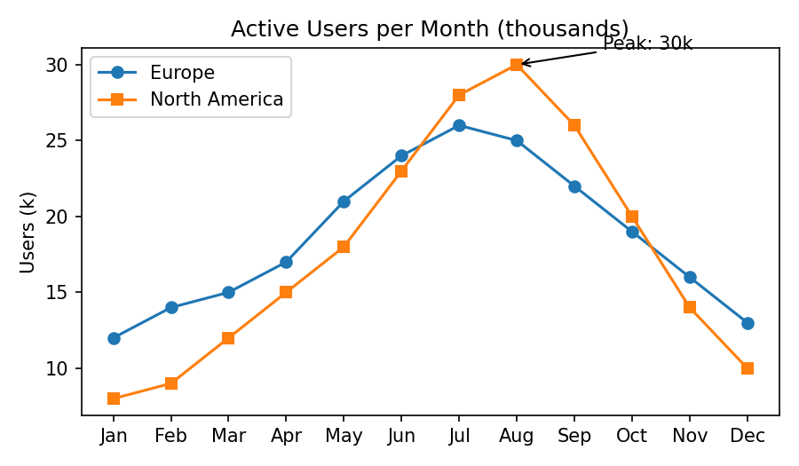
*The unlabelled line chart. Values can only be read from the geometry and gridlines.*

The line chart is the most interesting element. It has two series (Europe and North America) across 12 months. There are no labels on the data points, only gridlines and one annotation ("Peak: 30k").

---

## 2. Setup

`AI_PARSE_DOCUMENT` reads files from a stage. The stage **must use server-side encryption**:

```sql
CREATE DATABASE IF NOT EXISTS AI_PARSE_TEST;

CREATE STAGE IF NOT EXISTS AI_PARSE_TEST.PUBLIC.DOCS
  DIRECTORY  = (ENABLE = TRUE)
  ENCRYPTION = (TYPE = 'SNOWFLAKE_SSE');

PUT 'file://c:/.../agentic_test.pdf' @AI_PARSE_TEST.PUBLIC.DOCS
  AUTO_COMPRESS = FALSE OVERWRITE = TRUE;
```

> **Cost note:** `AI_PARSE_DOCUMENT` is billed per page processed, and AGENTIC is more expensive than OCR or LAYOUT. Check the Snowflake Service Consumption Table before you run it on a large corpus.

---

## 3. Parse once, query many times

AI functions cost credits on every call. So I parse the document **once per mode**, store the raw `VARIANT` in a table, and run all subsequent tests against that table at zero AI cost:

```sql
CREATE OR REPLACE TABLE AI_PARSE_TEST.PUBLIC.PARSE_RESULTS AS
SELECT 'OCR' AS mode,
       AI_PARSE_DOCUMENT(TO_FILE('@AI_PARSE_TEST.PUBLIC.DOCS', 'agentic_test.pdf'),
                         {'mode': 'OCR', 'page_split': true}, TRUE) AS res
UNION ALL
SELECT 'LAYOUT',
       AI_PARSE_DOCUMENT(TO_FILE('@AI_PARSE_TEST.PUBLIC.DOCS', 'agentic_test.pdf'),
                         {'mode': 'LAYOUT', 'page_split': true}, TRUE)
UNION ALL
SELECT 'AGENTIC',
       AI_PARSE_DOCUMENT(TO_FILE('@AI_PARSE_TEST.PUBLIC.DOCS', 'agentic_test.pdf'),
                         {'mode': 'AGENTIC', 'page_split': true}, TRUE);
```

Two details matter here:

- **`page_split: true`** returns one object per page with its own `content` (and, in AGENTIC, its own `images`).
- **The third argument, `TRUE`, is `return_error_details`.** It wraps the output in an envelope: `{ "value": {...}, "error": null, "metadata": {...} }`. As a result:
  - pages live under `res:value:pages`;
  - the page count lives under `res:metadata:pageCount`, **not** `res:value:metadata`.

  I got this wrong at first.

### Gotcha #1: the options object must be a literal

My first version was "elegant". It took the mode names from a `VALUES` list and built the options with `OBJECT_CONSTRUCT`:

```sql
-- DON'T do this
SELECT m.mode,
       AI_PARSE_DOCUMENT(TO_FILE(...), OBJECT_CONSTRUCT('mode', m.mode, 'page_split', TRUE), TRUE)
FROM (VALUES ('OCR'), ('LAYOUT'), ('AGENTIC')) m(mode);
```

OCR and LAYOUT worked. AGENTIC failed with:

```
Unsupported mode 'AGENTIC'. Supported modes: OCR, LAYOUT.
```

The same mode passed as a **literal** object constant, `{'mode':'AGENTIC', ...}`, works fine. In my tests (during the Preview), AGENTIC was only recognised when the options were known at compile time. If you build options dynamically, branch with literals instead.

---

## 4. What the AGENTIC output looks like

Before the tests, here is the shape of a single AGENTIC page, trimmed. Page 1 contains this bar chart:

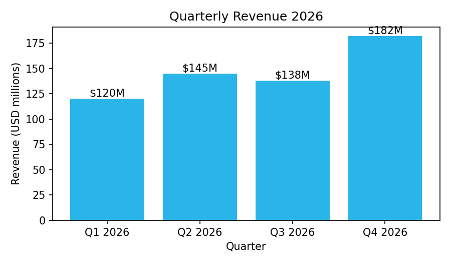
*img-0: the bar chart on page 1 of the test document.*

AGENTIC returns this for it:

```json
{
  "index": 0,
  "content": "# 2. Quarterly revenue (bar chart image)\n\n\n...",
  "dimensions": { "width": 1654, "height": 2339 },
  "images": [
    {
      "id": "img-0.jpeg",
      "top_left_x": 287, "top_left_y": 685,
      "bottom_right_x": 1361, "bottom_right_y": 1288,
      "results": {
        "image_type": "chart",
        "summary": "A bar chart showing the quarterly revenue for the year 2026, ...",
        "details": {
          "chart_type": "bar",
          "title": "Quarterly Revenue 2026",
          "x_axis": { "label": "Quarter", "units": null },
          "y_axis": { "label": "Revenue (USD millions)", "units": "USD millions" },
          "values_estimated": false,
          "series": [{
            "name": "Revenue",
            "unit": "USD millions",
            "points": [
              { "label": "Q1 2026", "value": 120, "value_precision": "exact", "value_range": null },
              { "label": "Q2 2026", "value": 145, "value_precision": "exact", "value_range": null }
            ]
          }],
          "key_values": ["Q1 2026 Revenue: $120M", "..."],
          "notes": "The chart displays exact values above each bar ..."
        }
      }
    }
  ]
}
```

Key observations:

- **`content` is still LAYOUT-style Markdown.** The image itself is just a placeholder, ``, and its `id` links it to the entry in `images[]`.
- **Every image has a bounding box** in page pixel coordinates.
- **AGENTIC returns descriptions, not pixels.** There is no base64 payload, and the `extract_images` option is not supported in this mode. If you need the actual image files, run LAYOUT with `extract_images` and join on `id`, or crop the PDF using the bounding box.
- **Each point carries its own confidence.**
  - `value_precision` is `exact` or `estimated`.
  - Estimated points also get a `value_range`, for example `[11.5, 12.5]`.
  - The chart as a whole gets a `values_estimated` flag.

---

## 5. The tests

### Test 1: what does each mode return?

```sql
SELECT r.mode,
       ANY_VALUE(r.res:error::string)          AS err,
       ANY_VALUE(r.res:metadata:pageCount::int) AS pages,
       SUM(LENGTH(p.value:content::string))    AS content_chars,
       SUM(ARRAY_SIZE(COALESCE(p.value:images, []))) AS images
FROM AI_PARSE_TEST.PUBLIC.PARSE_RESULTS r,
     LATERAL FLATTEN(r.res:value:pages) p
GROUP BY 1 ORDER BY 1;
```

| MODE | ERR | PAGES | CONTENT_CHARS | IMAGES |
|---|---|---|---|---|
| AGENTIC | | 4 | 2317 | **12** |
| LAYOUT | | 4 | 2319 | 0 |
| OCR | | 4 | 3181 | 0 |

- **OCR has the most text.** It reads every pixel of text, including text inside charts and screenshots, and dumps it into `content`.
- **LAYOUT and AGENTIC have almost identical `content`.** AGENTIC puts its added value in a separate `images` array instead of the text.
- **AGENTIC also reports `processedPageCount`** in its metadata.

> Side note: I originally wrote this query with correlated subqueries over `FLATTEN`. Snowflake rejected it with *"Unsupported subquery type"*. `LATERAL FLATTEN` + `GROUP BY` is the idiomatic way to aggregate over nested arrays.

### Test 2: image classification

```sql
SELECT p.value:index::int                         AS page,
       i.value:id::string                         AS img,
       i.value:results:image_type::string         AS image_type,
       i.value:results:details:chart_type::string AS chart_type,
       i.value:results:details:diagram_type::string AS diagram_type,
       i.value:results:summary::string            AS summary
FROM AI_PARSE_TEST.PUBLIC.PARSE_RESULTS r,
     LATERAL FLATTEN(r.res:value:pages) p,
     LATERAL FLATTEN(p.value:images) i
WHERE r.mode = 'AGENTIC'
ORDER BY page, img;
```

| PAGE | IMG | IMAGE_TYPE | CHART_TYPE | DIAGRAM_TYPE |
|---|---|---|---|---|
| 0 | img-0 | chart | bar | |
| 1 | img-1 | chart | line | |
| 1 | img-2 | chart | pie | |
| 1 | img-3 | chart | bar | |
| 1 | img-4 | chart | line | |
| 1 | img-5 | chart | bar | |
| 1 | img-6 | chart | scatter | |
| 2 | img-7 | diagram | | flowchart |
| 2 | img-8 | screenshot | | |
| 3 | img-9 | photo_with_text | | |
| 3 | img-10 | infographic | | |
| 3 | img-11 | other | | |

All 12 images were found and classified sensibly. Three things did not go as I expected:

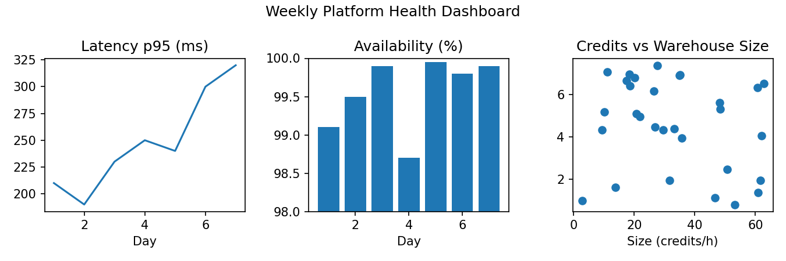
*The multi-panel dashboard. AGENTIC returned it as three separate images.*

1. **The multi-panel chart was split into three images** (img-4, img-5, img-6), each classified on its own as line, bar or scatter. The parser cuts images out before AGENTIC interprets them, so it saw three separate figures, and `multi_panel` never appeared. For a dashboard like this, getting each panel separately is arguably more useful anyway.
2. **The stacked bar chart is reported as `bar`.** The summary does say *"A stacked bar chart showing…"*, and the notes explain how the segment heights were derived.
3. **The image-based table and the scanned memo were never treated as images.** The layout engine recognised them as page content: it produced a proper Markdown table for the order and Markdown text for the memo in `content`, in both LAYOUT and AGENTIC. That is a good outcome, but it means the `table` and `document_page` types did not show up in an embedded-image PDF. They probably apply when the input is a standalone image file.

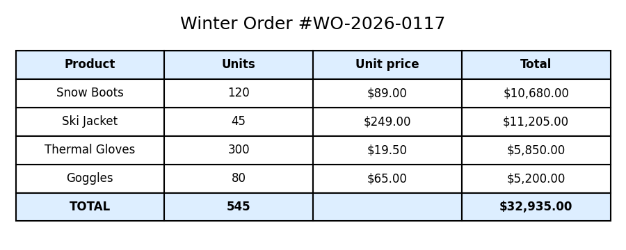
*The table rendered as an image.*

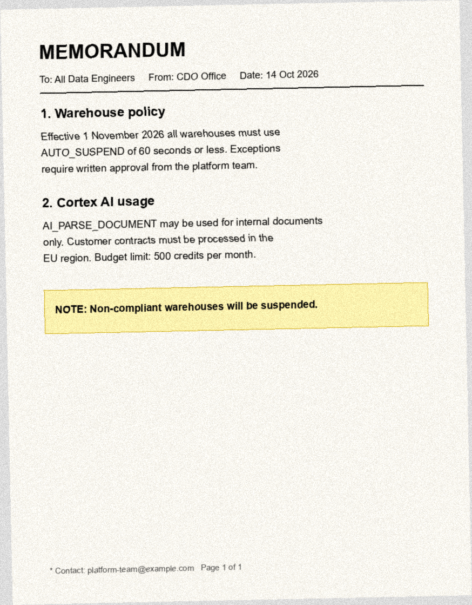
*The noisy, rotated "scan" of a memo.*

**Gotcha #2: the schema is not uniform.** Charts, diagrams and screenshots use the `summary` + `details` wrapper. `photo_with_text`, `infographic` and `other` return **flat** fields. These are the three images involved:

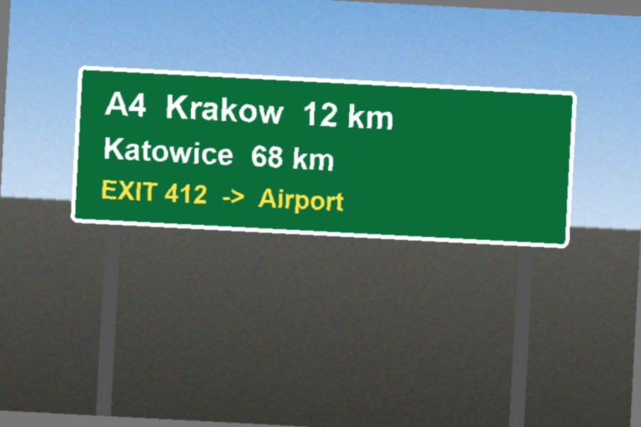
*img-9, classified as `photo_with_text`.*

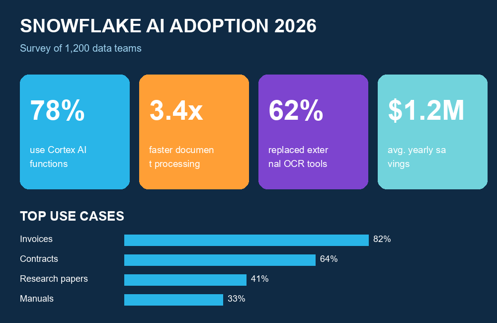
*img-10, classified as `infographic`.*


*img-11, classified as `other`: a decorative image with no information.*

And this is what came back for the first two:

```json
{ "image_type": "photo_with_text",
  "scene_description": "A green highway sign with white and yellow text indicating distances to Krakow and Katowice on the A4 highway, and an exit for the Airport.",
  "visible_text": ["A4 Krakow 12 km", "Katowice 68 km", "EXIT 412 -> Airport"] }

{ "image_type": "infographic",
  "title": "SNOWFLAKE AI ADOPTION 2026",
  "key_values": ["78%", "3.4x", "62%", "$1.2M", "82% (Invoices)", "..."],
  "sections": [
    { "heading": "Key Metrics",
      "key_facts": ["78% use Cortex AI functions", "3.4x faster document processing",
                    "62% replaced external OCR tools", "$1.2M avg. yearly savings"] } ] }
```

If you build a view on top of AGENTIC output, use `COALESCE(results:summary, results:scene_description, results:description)` and similar fallbacks. Do not assume one path works for every type.

### Test 3: charts become tables

This is the headline feature. With two extra `LATERAL FLATTEN`s, every chart in the document becomes a relational dataset:

```sql
SELECT i.value:id::string                     AS img,
       i.value:results:details:title::string  AS title,
       s.value:name::string                   AS series,
       s.value:unit::string                   AS unit,
       pt.value:label::string                 AS label,
       pt.value:value::string                 AS value
FROM AI_PARSE_TEST.PUBLIC.PARSE_RESULTS r,
     LATERAL FLATTEN(r.res:value:pages) p,
     LATERAL FLATTEN(p.value:images) i,
     LATERAL FLATTEN(i.value:results:details:series) s,
     LATERAL FLATTEN(s.value:points) pt
WHERE r.mode = 'AGENTIC'
  AND i.value:results:image_type = 'chart'
ORDER BY img, series, pt.index;
```

Two of the source charts, for reference:

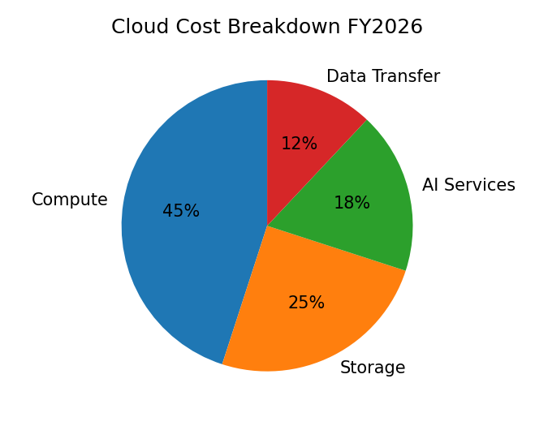
*img-2: the pie chart.*

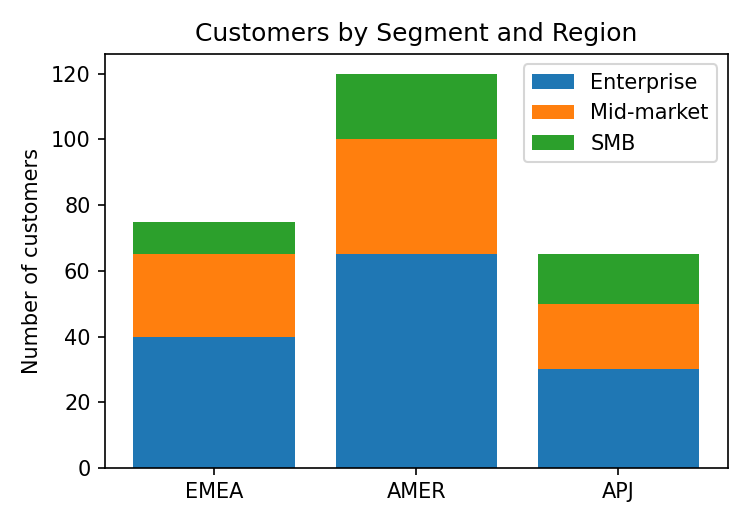
*img-3: the stacked bar chart. Its segments have no value labels.*

The query returned **84 rows**. A selection:

| IMG | TITLE | SERIES | UNIT | LABEL | VALUE |
|---|---|---|---|---|---|
| img-0 | Quarterly Revenue 2026 | Revenue | USD millions | Q4 2026 | 182 |
| img-2 | Cloud Cost Breakdown FY2026 | Cloud Cost Share | % | Compute | 45 |
| img-2 | Cloud Cost Breakdown FY2026 | Cloud Cost Share | % | AI Services | 18 |
| img-3 | Customers by Segment and Region | Enterprise | | AMER | 65 |
| img-3 | Customers by Segment and Region | Mid-market | | AMER | 35 |
| img-3 | Customers by Segment and Region | SMB | | AMER | 20 |
| img-4 | Latency p95 (ms) | p95 Latency | ms | 7 | 320 |
| img-5 | Availability (%) | Availability | % | 4 | 98.7 |
| img-6 | Credits vs Warehouse Size | Data Points | | Point 1 | [2.8,1] |

A few things worth noting:

- **Stacked bars are split correctly per segment.** None of these numbers is printed on the image. They come from the heights of the coloured blocks, and they match the source data.
- **Units are populated** where the axis or title made them obvious ("USD millions", "%", "ms", "thousands").
- **Scatter points come back as `[x, y]` arrays.** The model also noted *"There are 29 distinct data points plotted."*

### Test 4: how accurate is it on a chart with no labels?

This is the line chart again (img-1):


The line chart has no labels on its data points. I joined the extracted points to the ground truth used to generate the chart:

```sql
WITH truth AS (
  SELECT column1 AS series, column2 AS m, column3 AS v FROM VALUES
  ('Europe','Jan',12),('Europe','Feb',14), /* ... */ ('Europe','Dec',13),
  ('North America','Jan',8), /* ... */ ('North America','Dec',10)
),
ext AS (
  SELECT s.value:name::string AS series, pt.value:label::string AS m, pt.value:value::float AS v
  FROM AI_PARSE_TEST.PUBLIC.PARSE_RESULTS r,
       LATERAL FLATTEN(r.res:value:pages) p,
       LATERAL FLATTEN(p.value:images) i,
       LATERAL FLATTEN(i.value:results:details:series) s,
       LATERAL FLATTEN(s.value:points) pt
  WHERE r.mode = 'AGENTIC'
    AND i.value:results:details:chart_type = 'line'
    AND i.value:results:details:title ILIKE '%Active Users%'
)
SELECT t.series,
       COUNT(e.v)                     AS matched_points,
       SUM(IFF(e.v = t.v, 1, 0))      AS exact,
       ROUND(AVG(ABS(e.v - t.v)), 2)  AS mae,
       MAX(ABS(e.v - t.v))            AS max_err
FROM truth t
LEFT JOIN ext e ON e.series = t.series AND e.m = t.m
GROUP BY 1;
```

| SERIES | MATCHED_POINTS | EXACT | MAE | MAX_ERR |
|---|---|---|---|---|
| Europe | 12 | 12 | 0 | 0 |
| North America | 12 | 12 | 0 | 0 |

**All 24 points matched exactly.** Interestingly, the model is modest about it. Most points are flagged `"value_precision": "estimated"` with a ±0.5 `value_range`, and only the points sitting on a gridline or next to the annotation are marked `exact`. That behaviour is what you want: the confidence fields let you route uncertain values to human review.

To be fair, this is a clean, synthetic matplotlib chart on integer values with a visible grid. Expect lower accuracy on low-resolution scans, dense charts or log scales. The point is that the `value_range` field gives you a programmatic way to detect that case.

### Test 5: diagrams as graphs, screenshots as state

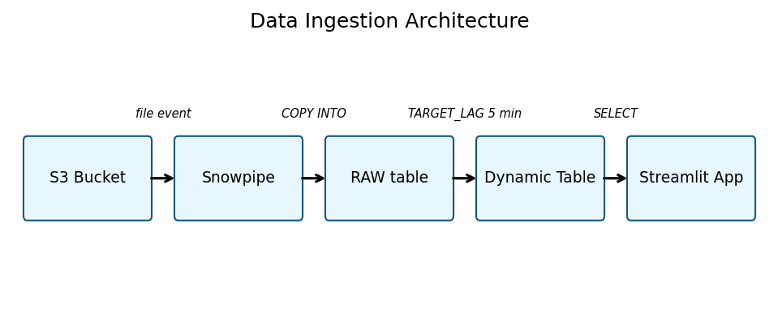
*img-7: the pipeline flowchart with labelled edges.*

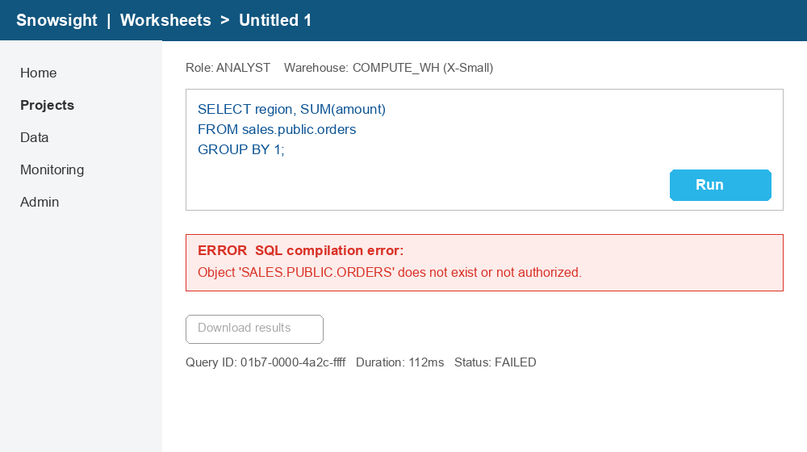
*img-8: the fake Snowsight screenshot. Note the greyed-out "Download results" button.*

```sql
SELECT 'diagram edge' AS kind,
       c.value:from::string || ' -> ' || c.value:to::string AS item,
       c.value:label::string AS extra
FROM AI_PARSE_TEST.PUBLIC.PARSE_RESULTS r,
     LATERAL FLATTEN(r.res:value:pages) p,
     LATERAL FLATTEN(p.value:images) i,
     LATERAL FLATTEN(i.value:results:details:connections) c
WHERE r.mode = 'AGENTIC' AND i.value:results:image_type = 'diagram'
UNION ALL
SELECT 'screenshot', s.value::string, i.value:results:details:app_or_page::string
FROM AI_PARSE_TEST.PUBLIC.PARSE_RESULTS r,
     LATERAL FLATTEN(r.res:value:pages) p,
     LATERAL FLATTEN(p.value:images) i,
     LATERAL FLATTEN(i.value:results:details:state_signals) s
WHERE r.mode = 'AGENTIC' AND i.value:results:image_type = 'screenshot';
```

| KIND | ITEM | EXTRA |
|---|---|---|
| diagram edge | s3_bucket -> snowpipe | file event |
| diagram edge | snowpipe -> raw_table | COPY INTO |
| diagram edge | raw_table -> dynamic_table | TARGET_LAG 5 min |
| diagram edge | dynamic_table -> streamlit_app | SELECT |
| screenshot | ERROR SQL compilation error: Object 'SALES.PUBLIC.ORDERS' does not exist or not authorized. | Snowsight \| Worksheets > Untitled 1 |
| screenshot | Status: FAILED | Snowsight \| Worksheets > Untitled 1 |
| screenshot | Download results button is disabled | Snowsight \| Worksheets > Untitled 1 |

**The diagram** came back as a proper edge list, with a label on every arrow. Each component also gets a role: S3 Bucket is a *Data Source*, Snowpipe an *Ingestion Service*, Streamlit App a *Data Consumer/Visualization*. You could load this straight into a graph table, or compare architecture diagrams across documents.

**The screenshot** result is the most impressive one. Besides the full `visible_text` (18 lines), AGENTIC returned three `state_signals`. The third, *"Download results button is disabled"*, **is not written anywhere on the image**. The model inferred it from the greyed-out styling of the button. It also produced a `purpose` field:

> *"The user is attempting to execute a SQL query in a Snowflake worksheet, which has failed due to a compilation error regarding object existence or authorization."*

For support-ticket triage, where users attach screenshots instead of error text, this is very useful.

### Test 6: fact recall across modes

The final test answers the practical question: **if I search the output of each mode for a specific fact, will I find it?**

```sql
WITH txt AS (
  SELECT r.mode,
         LISTAGG(p.value:content::string, '\n') AS content,
         COALESCE(ARRAY_TO_STRING(ARRAY_AGG(p.value:images::string), ' '), '') AS images
  FROM AI_PARSE_TEST.PUBLIC.PARSE_RESULTS r,
       LATERAL FLATTEN(r.res:value:pages) p
  GROUP BY 1
),
facts AS (
  SELECT column1 AS fact, column2 AS needle FROM VALUES
  ('Native table: 2,310 customers',              '2,310'),
  ('Bar label: $182M',                           '182'),
  ('Line chart: Europe/Jul = 26 (no label)',     '"value":26'),
  ('Stacked: AMER Enterprise = 65 (no label)',   '"value":65'),
  ('Image table: $32,935.00',                    '32,935'),
  ('Diagram: TARGET_LAG 5 min',                  'TARGET_LAG 5 min'),
  ('Screenshot: SALES.PUBLIC.ORDERS error',      'SALES.PUBLIC.ORDERS'),
  ('Scanned memo: 500 credits limit',            '500 credits'),
  ('Photo: EXIT 412',                            'EXIT 412'),
  ('Infographic: $1.2M',                         '$1.2M')
)
SELECT f.fact,
       MAX(IFF(t.mode = 'OCR',     CONTAINS(t.content || t.images, f.needle), NULL)) AS ocr,
       MAX(IFF(t.mode = 'LAYOUT',  CONTAINS(t.content || t.images, f.needle), NULL)) AS layout,
       MAX(IFF(t.mode = 'AGENTIC', CONTAINS(t.content || t.images, f.needle), NULL)) AS agentic
FROM facts f CROSS JOIN txt t
GROUP BY f.fact ORDER BY f.fact;
```

| Fact | OCR | LAYOUT | AGENTIC |
|---|---|---|---|
| Native table: 2,310 customers | ✅ | ✅ | ✅ |
| Bar label: $182M | ✅ | ❌ | ✅ |
| Line chart: Europe/Jul = 26 (no label) | ❌ | ❌ | ✅ |
| Stacked: AMER Enterprise = 65 (no label) | ❌ | ❌ | ✅ |
| Image table: $32,935.00 | ✅ | ✅ | ✅ |
| Diagram: TARGET_LAG 5 min | ✅ | ❌ | ✅ |
| Screenshot: SALES.PUBLIC.ORDERS error | ✅ | ❌ | ✅ |
| Scanned memo: 500 credits limit | ✅ | ✅ | ✅ |
| Photo: EXIT 412 | ✅ | ❌ | ✅ |
| Infographic: $1.2M | ✅ | ❌ | ✅ |
| **Score** | **8/10** | **3/10** | **10/10** |

This is the most important table in the article, and it is more nuanced than "AGENTIC wins".

- **OCR is a surprisingly strong baseline for text recall.** It finds every fact that is *printed* somewhere. But it loses all meaning. The diagram comes out as:

  ```
  file event COPY INTO TARGET_LAG 5 min SELECT
  S3 Bucket Snowpipe RAW table Dynamic Table > Streamlit App
  ```

  You know the words; you don't know what is connected to what. The pie chart comes out as `Al Services Compute 45% 18% 25%`. Good luck matching percentages to slices.
- **LAYOUT is the worst of the three for image-heavy documents.** It gives the best structure for native text and tables, but it replaces images with placeholders and **drops their text entirely**. The exceptions are the image table and the scan, which its layout engine absorbed as page content.
- **AGENTIC is the only mode that recovers values that are not printed on the page** (rows 3 and 4). It is also the only mode that tells you *what the text means*: which slice is 45%, which arrow carries `TARGET_LAG 5 min`, and that the button is disabled.

---

## 6. Smaller differences worth knowing

Comparing the raw outputs side by side showed a few quirks:

| Where | OCR | LAYOUT / AGENTIC |
|---|---|---|
| Email in the scanned memo | `platform-team@example.com` ✅ | `platform-aram@example.com` ❌ |
| Image table | `Ski Jacket` ✅ | `Ski jacket` |
| "AI" in body text | `Cortex Al` ❌ (lowercase L) | `Cortex AI` ✅ |
| `>` character | `>` | `&gt;` (HTML entity) |

None of the modes is perfect on noisy scans. Also note the `&gt;` in LAYOUT/AGENTIC Markdown: if you feed `content` downstream, unescape HTML entities first.

---

## 7. What did it cost?

AI credits come from `SNOWFLAKE.ACCOUNT_USAGE.CORTEX_DOCUMENT_PROCESSING_USAGE_HISTORY`, and warehouse time comes from `QUERY_HISTORY`:

```sql
SELECT query_id, model_name AS mode, page_count, credits_used
FROM SNOWFLAKE.ACCOUNT_USAGE.CORTEX_DOCUMENT_PROCESSING_USAGE_HISTORY
WHERE function_name = 'AI_PARSE_DOCUMENT'
  AND start_time >= DATEADD(day, -1, CURRENT_TIMESTAMP());
```

USD amounts below assume an illustrative $3 per credit. Your actual price depends on your contract and region.

| Query | Mode | Pages | AI credits | WH credits (X-Small) | Quality |
|---|---|---|---|---|---|
| `CREATE TABLE ... AS` (OCR + LAYOUT in one statement) | OCR | 4 | 0.00272 | 0.0113 (shared, 40.8 s) | 8/10 facts, no structure, 0/12 images understood |
| same | LAYOUT | 4 | 0.01464 | (shared) | Excellent structure, 3/10 facts, images are placeholders only |
| `INSERT ... 'AGENTIC'` | AGENTIC | 4 | 0.03272 | 0.0046 (16.5 s) | 10/10 facts, 12/12 images classified, 24/24 chart points exact |
| Tests 1–6 (31 queries on the stored `VARIANT`) | none | 0 | 0 | 0.0014 (5.0 s) | No AI cost: the document was parsed only once |
| **Total** | | 12 | **0.050** | **0.017** | **≈ $0.20** |

Normalised per page:

| Mode | Credits / page | Credits / 1,000 pages | ≈ USD / 1,000 pages | vs OCR |
|---|---|---|---|---|
| OCR | 0.00068 | 0.68 | $2.04 | 1× |
| LAYOUT | 0.00366 | 3.66 | $10.98 | 5.4× |
| AGENTIC | 0.00818 | 8.18 | $24.54 | 12× (2.2× LAYOUT) |

Two observations:

- **AGENTIC is billed per page, like the other modes.** This 4-page document has 12 images and cost 0.0327 credits, which is 0.00818 credits per page.
- **The warehouse barely matters.** Warehouse credits pay for the wait while the AI service works, not for the AI work itself. Use an X-Small warehouse, and parse each document once.

---

## 8. When to use which mode

| Use case | Recommended mode |
|---|---|
| Plain text extraction for search or embeddings, text-only documents | **OCR**: cheapest, high text recall |
| Contracts, forms, reports with native tables; RAG chunking by headings | **LAYOUT**: best structure |
| Financial and analyst reports with charts; technical docs with diagrams; tickets with screenshots | **AGENTIC** |
| You need the actual image files | **LAYOUT** + `extract_images` (not available in AGENTIC) |

A pragmatic pattern for mixed corpora:

1. Run **LAYOUT** first.
2. Re-run **AGENTIC** only on documents whose `content` contains image placeholders:

```sql
SELECT relative_path
FROM layout_results
WHERE res:value:pages::string LIKE '%![img-%';
```

---

## 9. Summary of gotchas

1. **Pass options as a literal** (`{'mode':'AGENTIC', ...}`). Options built with `OBJECT_CONSTRUCT` from a column were rejected with *"Unsupported mode 'AGENTIC'"* in my Preview tests.
2. **With `return_error_details = TRUE`**, pages are under `res:value:pages` and the page count is under `res:metadata:pageCount`.
3. **The image result schema varies by type.**
   - Charts, diagrams and screenshots use `summary` + `details`.
   - Photos, infographics and `other` use flat fields.
4. **No pixels:** AGENTIC returns interpretations only; `extract_images` is not supported.
5. **Embedded images are pre-segmented.** A multi-panel figure may come back as several images, and a "table as an image" may be absorbed into Markdown `content` instead of appearing in `images[]`.
6. **Use `value_precision` / `value_range`** to decide which extracted numbers need human review.
7. **The stage must be SSE-encrypted.** Parse once, store the `VARIANT`, and query it as many times as you like.

---

## Closing thoughts

AGENTIC moves `AI_PARSE_DOCUMENT` from *reading* documents to *understanding* them. The test that convinced me was not the classification or the summaries. It was the 24-point, unlabelled line chart that came back as an exact relational table, with honest confidence intervals attached, and was queryable with four `LATERAL FLATTEN`s.

It is still in Preview, and it has rough edges (the literal-options quirk, a non-uniform schema, no image extraction). But for any corpus where the important information lives in charts, diagrams or screenshots, it removes a whole class of custom vision pipelines that we used to build by hand.

*The generator script, the test PDF, all SQL and the raw JSON outputs of all three modes are available alongside this article.*
